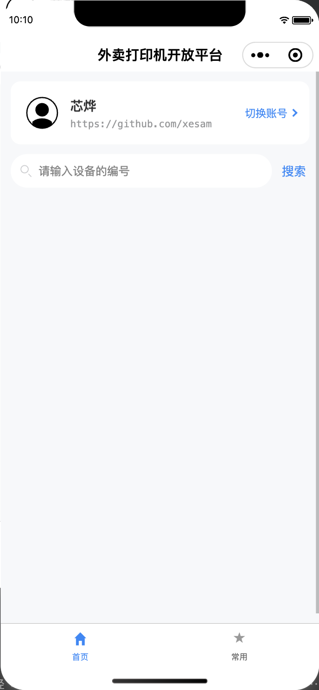
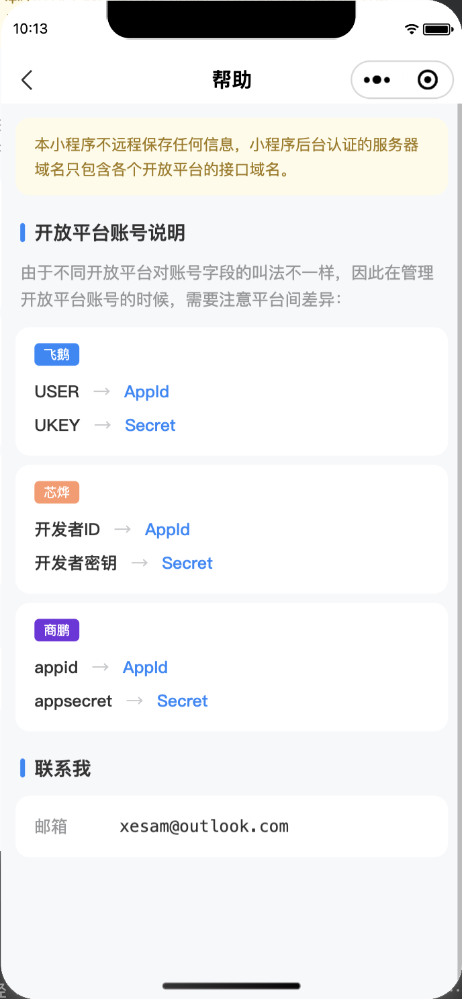

# 外卖打印机开放平台聚合管理

微信原生小程序，统一管理飞鹅、芯烨、商鹏三家云打印厂商的开放平台账号、打印设备和打印操作。产品术语中的"常用设备"对应实现位于 `miniprogram/modules/device/frequent/`，领域术语定义见 `docs/domain-glossary.md`。

## 【重要说明】

- 所有数据都保存在本地，本项目没有远端后台服务；
- 网络请求直连打印机官方开放平台，不使用任何其他网络服务；

## 示例截图

<table>
  <tr>
    <td></td>
    <td></td>
    <td></td>
  </tr>
</table>

## 开发环境

微信开发者工具的项目根目录是仓库根目录，源码位于 `miniprogram/`。新环境首次使用时执行：

```sh
cd miniprogram
npm install
```

然后在微信开发者工具中执行“工具 → 构建 npm”，生成本地的 `miniprogram/miniprogram_npm/`。该目录和 `node_modules/` 不纳入版本控制。

仓库默认使用官方测试号 `touristappid`，克隆后可直接打开编译。接入自己的小程序时，把真实 appid 和本地设置写入被忽略的 `project.private.config.json`（结构参考 `project.config.json`），不要提交真实 appid。

页面开发遵循仓库根目录的 `AGENTS.md` 约定。项目没有命令行测试、lint 或构建脚本，改动后的验证方式是使用微信开发者工具编译、模拟器检查和预览。

## License

本项目基于 [ISC License](./LICENSE) 开源。
